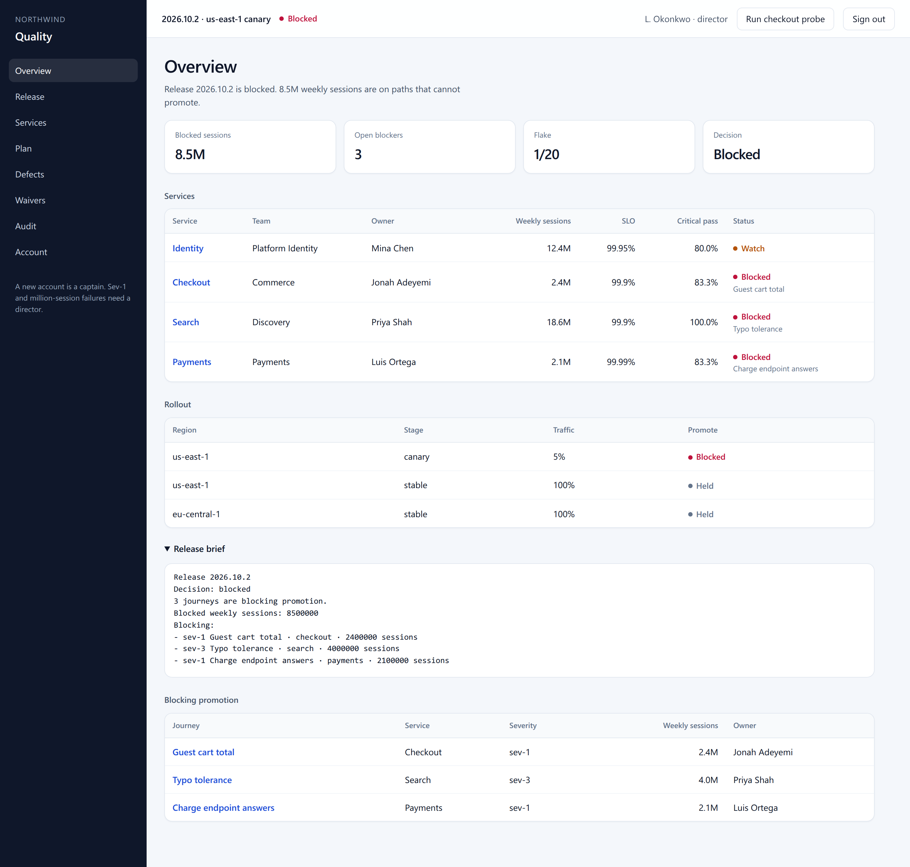
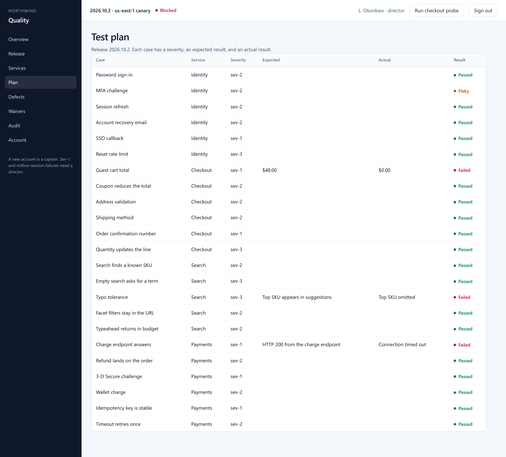

# Northwind Quality

[](https://github.com/SeifCoderXC/northwind-quality/actions/workflows/ci.yml)

Release control plane for Northwind. It decides whether release `2026.10.2` can leave a 5% canary in us-east-1. Cases live in SQLite. A failure blocks when it is critical, sev-1, or it covers at least 1 million weekly sessions. A sev-1 waiver stays pending until a different director approves it.

## Desk

Release `2026.10.2` is blocked. The signed-in director in these pictures is L. Okonkwo. 23 journeys are scored. The catalog lists 14,203 cases, and those cases were not executed. Flake is 1/20, 5.000 percent, at the limit, so that gate is clear. Checkout, Search, and Payments are blocked. Identity is on watch because MFA challenge is flaky. The blocking journeys are Guest cart total, Typo tolerance, and Charge endpoint answers.





High reach says `1 non-sev-1 failure over 1M sessions. 3 blocking journeys are over 1M sessions.` Typo tolerance is the failure outside sev-1. Guest cart total and Charge endpoint answers are the other two. Guest cart total expected $48.00 and showed $0.00. Search critical pass stays 100% and the cell says that count excludes Typo tolerance. Defects lists those journeys, and the keys become links when Jira is configured.

## Core

| Layer | In this product |
|---|---|
| TypeScript | `src/server.ts`, `src/db.ts`, `src/auth.ts`, `src/jira.ts`, `src/oidc.ts`, `src/local-directory.ts` |
| Playwright | Checkout probe, and `test/api.test.js` uses Playwright's API client |
| REST + Postman | `/api/*` and `postman/Northwind-Quality.postman_collection.json` |
| SQL | `sql/schema.sql`, SQLite at `data/quality.sqlite` |
| Jira | Outbox rows for blocking cases. Live push turns on with env vars below. No TestRail |
| GitHub Actions | `.github/workflows/ci.yml` runs the tests, then builds and checks the image |
| Plan | Plan page: case, severity, expected, actual |

## Accounts

Local seed only. Change `QUALITY_DEMO_PASSWORD` before this process is reachable beyond your machine.

Directory sign-in is optional. Copy `.env.example` to `.env` and set `OIDC_CLIENT_ID` and `OIDC_CLIENT_SECRET` there. `npm run directory` listens on http://127.0.0.1:4391. A public issuer has to be `https`. Loopback may use `http`. The names are:

- `OIDC_ISSUER_URL`
- `OIDC_CLIENT_ID`
- `OIDC_CLIENT_SECRET`
- `OIDC_GROUP_CLAIM`
- `OIDC_DIRECTOR_GROUP`

The sign-in page offers **Sign in with your directory** when those settings are present. The directory asks for its own account before it sends the browser back. A person in `northwind-directors` becomes a director. Anyone else with a group list becomes a captain. A missing group list is refused. The directory password is not stored on the desk, and the directory account cannot sign in as rahman or okonkwo. If the directory process is stopped, the desk stays on the sign-in page and does not open a session. The client secret stays in `.env`.

| Username | Directory name | Desk role | Password |
|---|---|---|---|
| mchen | Mina Chen | director | directory-local |
| lokoro | Leila Okoro | captain | directory-local |
| padebayo | Paul Adebayo | refused, no group list | directory-local |

The sign-in screen has **Create account**. A new account is a captain. Sending `role: director` is rejected. A director issues a one-time invite from Account, or `POST /api/invites`, and the new person enters that code on the create-account form. A captain cannot approve a sev-1 or a failure that covers a million weekly sessions. Those waivers stay pending until a different director approves them. Account changes the password. Defects lists the Jira outbox. Overview includes a release brief.

The release page counts scored journeys. The figure 14,203 is the catalog size. The flake gate uses an integer comparison. The label is truncated to three decimals and says whether the rate is above, at, or within 5%.

A session ends after 30 minutes without a request, and after 12 hours in any case. `QUALITY_IDLE_MS` overrides the idle window. The cookie lifetime stays 12 hours. An existing `data/quality.sqlite` gains `sessions.last_seen_at` and `sessions.ended_reason` the next time the database is opened. When that idle end happens during use, the desk returns to sign-in and says the session timed out. A later request with the same cookie keeps that sentence. Sign-out removes the session.

Five rejected passwords for one username inside 60 seconds lock the next attempt. `QUALITY_LOGIN_WINDOW_MS` overrides that window. The attempts stay in SQLite across a restart. A body that is not a JSON object returns 400.

The workspace includes the newest 40 audit rows. `GET /api/audit?before=<id>` loads the next older page. The Audit screen asks for older decisions when more rows exist. A release filter that matches nothing says so.

The page does not load a third-party font. CSS and JavaScript revalidate with an ETag. HTML stays uncached. Responses send `nosniff`, deny framing, and a content security policy of `default-src 'self'`.

Seeded accounts, if you need the director:

| Username | Role | Password |
|---|---|---|
| rahman | Release captain | northwind-local |
| okonkwo | Director | northwind-local |

## Run

```bash
npm ci
npm test
npm start
```

Open http://127.0.0.1:4321. Local accounts work with no `.env`. For directory sign-in, copy `.env.example` to `.env`, set a client id and a client secret, then start `npm run directory` before the desk. The directory listens on http://127.0.0.1:4391.

## Deploy

```bash
docker build -t northwind-quality .
docker run --rm -p 4321:4321 -e QUALITY_DEMO_PASSWORD='choose-a-password' northwind-quality
```

The image sets `HOST=0.0.0.0`. The process exits if `QUALITY_DEMO_PASSWORD` is missing or still `northwind-local`. Loopback on a workstation still accepts the local password.

The image serves the control plane. It does not download a browser. The checkout probe needs Chrome on the machine that runs it. The rest of the product runs without it.

## CI and CD

`.github/workflows/ci.yml` is the pipeline.

- **Test** runs on every push and pull request: `npm ci`, Chromium, and `npm test`. The job fails if `.env` is tracked or a private key is in the tree.
- **Image** runs after the tests pass, on every push and pull request. It builds the Docker image, checks `GET /api/health`, and checks that the local password cannot bind in public.

The pipeline does not deploy to a host and does not publish the image to a registry.

## Criteria

| Criterion | In this repository |
|---|---|
| TypeScript | Server, database, auth, Jira client, and local directory |
| Playwright | Checkout probe and the test suite |
| REST and Postman | `/api/*` and `postman/Northwind-Quality.postman_collection.json` |
| SQL | `sql/schema.sql` and SQLite |
| Jira | Outbox plus a live push when the four environment values are set |
| GitHub Actions | Test job, then the image job on `main` |
| Plan | Plan page: case, severity, expected, actual |

TestRail is not part of this product. A cloud deploy, a public image registry, and Chrome inside the image are not part of it either.

## Jira

Blocking cases are stored in `jira_outbox`. Nothing is sent until all four are set:

- `JIRA_BASE_URL`
- `JIRA_EMAIL`
- `JIRA_TOKEN`
- `JIRA_PROJECT`

On startup the server reads `.env` for any of those that are empty in the process environment. That file is gitignored. A value already set in the process stays as it is. The workspace reports `jiraBrowse` as `{JIRA_BASE_URL}/browse` and the Defects page links each issue key there. The token stays on the server. If Jira cannot be reached, the workspace still opens and the defect stays queued for the next try.
